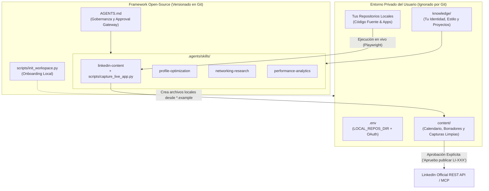

# LinkedIn Personal Brand Agent · Local-First AI Assistant (Antigravity + MCP)

Un sistema de gestión estratégica de marca profesional y asistente editorial para **LinkedIn**, diseñado bajo una arquitectura **Local-First (Privacidad por Diseño)** y **Human-in-the-Loop (Autonomía Supervisada)** para **Google Antigravity** y clientes compatibles con **MCP (Model Context Protocol)**.

A diferencia de los generadores de texto genéricos o los bots de automatización web (que arriesgan el bloqueo de tu cuenta por scraping), este agente vive en tu máquina local, **inspecciona y ejecuta tus repositorios reales en vivo para obtener capturas de pantalla limpias**, redacta contenido libre de alucinaciones basado en tu propia base de conocimiento y se conecta únicamente con la **API Oficial de LinkedIn (`w_member_social`)** bajo tu aprobación explícita.

---

## Características Principales

1. **Privacidad Local por Diseño (Como un Servidor MCP Personal):**
   - Tus proyectos, biografía, borradores, contactos, métricas y tokens OAuth (`knowledge/`, `content/`, `networking/`, `analytics/`, `.env`) **están excluidos de Git por defecto**.
   - Cuando clonas este repositorio, un script de inicialización (`python scripts/init_workspace.py`) genera tu entorno privado local a partir de plantillas `.example`, adaptándose al 100% a tu propio perfil profesional.
2. **Ejecución en Vivo y Capturas Limpias (`capture_live_app.py`):**
   - El agente no habla de oído sobre tu código: entra a tu carpeta local de repositorios (`LOCAL_REPOS_DIR`), levanta la aplicación en vivo (ej. `Streamlit`, `Dash`, `React`, `FastAPI`), navega por sus pestañas con Playwright en resolución Retina (`device_scale_factor=2`) y almacena las **capturas de pantalla limpias** listas para adjuntar en LinkedIn.
3. **Approval Gateway Obligatorio (Human-in-the-Loop):**
   - Gobernado por [`AGENTS.md`](./AGENTS.md): el agente puede investigar, redactar y preparar recursos visuales, pero **jamás publicará nada sin tu confirmación explícita por código de borrador** (ej. `"Apruebo publicar LI-001"`).
4. **4 Skills Nativos de Descubrimiento Automático (`.agents/skills/`):**
   - **`linkedin-content`**: Redacción de publicaciones, ejecución de apps para capturas en vivo y gestión del calendario editorial.
   - **`profile-optimization`**: Auditoría y redacción estratégica de Titular (*Headline*), Acerca de (*About*), Destacados (*Featured*) y Proyectos.
   - **`networking-research`**: Investigación en fuentes abiertas sobre empresas, laboratorios y oportunidades, más redacción de notas de conexión (200-300 caracteres).
   - **`performance-analytics`**: Registro y evaluación de métricas de impacto para iterar la estrategia editorial.

---

## Arquitectura del Sistema



---

## Instalación y Puesta en Marcha (Para Cualquier Usuario)

### 1. Clonar el repositorio

```bash
git clone https://github.com/Dmgar/linkedin-personal-brand-agent.git
cd linkedin-personal-brand-agent
```

### 2. Inicializar tu espacio privado local

Ejecuta el script de onboarding para generar tus archivos personales locales (`.env`, `knowledge/professional-identity.md`, `content/editorial-calendar.md`, etc.) a partir de las plantillas `.example`:

```bash
python scripts/init_workspace.py
```

*(Nota: Todos los archivos generados por este comando están protegidos por `.gitignore` para que tu información personal nunca se suba por accidente).*

### 3. Instalar el entorno para capturas en vivo (Opcional pero recomendado)

Con [`uv`](https://docs.astral.sh/uv/) o `pip`:

```bash
uv sync
```

### 4. Configurar a tu medida en 2 minutos

1. Abre `.env` y define `LOCAL_REPOS_DIR` apuntando a la carpeta donde guardas tus proyectos de programación.
2. Abre la carpeta `linkedin-personal-brand-agent` como Workspace en **Google Antigravity** y pídele en el chat:
   > *"Analiza mis proyectos en `LOCAL_REPOS_DIR` y ayúdame a completar mi `knowledge/professional-identity.md` y las fichas en `knowledge/projects/`."*

---

## Uso Diario con el Agente

Una vez inicializado tu perfil local, puedes usar instrucciones directas como:

- **Redactar y capturar un proyecto en vivo:**
  > *"Prepárame el borrador `LI-001` sobre mi proyecto `[nombre-del-repo]`. Corre la aplicación en vivo para ver qué tiene y guárdame las capturas limpias en `content/assets/LI-001/`."*
- **Optimizar tu perfil de LinkedIn:**
  > *"Usa el skill `profile-optimization` para proponerme 3 opciones de Titular (Headline), una nueva sección Acerca de y qué proyectos poner en Destacados."*
- **Planificar el calendario mensual:**
  > *"Revisa `content/editorial-calendar.md` y arma la rotación de las próximas 4 semanas (Martes de Proyectos y Viernes de Conocimiento Aplicado)."*
- **Investigar oportunidades y networking:**
  > *"Usa `networking-research` para investigar equipos de datos/ingeniería en las empresas de `networking/target-companies.md` y prepárame 3 notas de conexión."*

---

## Conexión con LinkedIn mediante MCP / API Oficial (Fase 2)

Por seguridad y cumplimiento de los Términos de Servicio de LinkedIn, este proyecto **no utiliza bots de navegador ni scraping**. La publicación directa se realiza mediante el estándar MCP sobre la API oficial de LinkedIn:

1. Entra en [LinkedIn Developers](https://www.linkedin.com/developers/apps) y crea una aplicación.
2. En la pestaña **Products**, solicita acceso a:
   - *Share on LinkedIn* (otorga el permiso `w_member_social`).
   - *Sign In with LinkedIn using OpenID Connect* (otorga `openid` y `profile`).
3. En la pestaña **Auth**, añade `http://localhost:3000/callback` en *Authorized redirect URLs* y copia tus credenciales en tu archivo `.env` local.
4. Registra el servidor MCP en `%USERPROFILE%\.gemini\config\mcp_config.json` manteniendo la herramienta `create_post` bajo confirmación manual.

---

## Estructura del Proyecto

```text
linkedin-personal-brand-agent/
├── AGENTS.md                                   # Gobernanza maestra y Approval Gateway
├── README.md                                   # Documentación general del proyecto
├── .env.example                                # Plantilla de configuración y rutas locales
├── .gitignore                                  # Aislamiento estricto de archivos personales
├── pyproject.toml                              # Dependencias del motor de capturas (Playwright)
├── LICENSE                                     # Licencia MIT
│
├── scripts/
│   └── init_workspace.py                       # Inicializador automático de archivos locales
│
├── .agents/
│   └── skills/                                 # Skills nativos de Google Antigravity
│       ├── linkedin-content/
│       │   ├── SKILL.md                        # Flujo editorial y reglas de estilo
│       │   └── scripts/
│       │       └── capture_live_app.py         # Motor de ejecución en vivo y capturas limpias
│       ├── profile-optimization/
│       │   └── SKILL.md                        # Auditoría de perfil (Headline, About, Featured)
│       ├── networking-research/
│       │   └── SKILL.md                        # Investigación de empresas y notas de contacto
│       └── performance-analytics/
│           └── SKILL.md                        # Seguimiento de métricas de impacto
│
├── knowledge/                                  # Base de conocimiento (Archivos reales ignorados por Git)
│   ├── professional-identity.example.md        # Plantilla de identidad y pilares
│   ├── writing-style.example.md                # Plantilla de tono y formato
│   ├── skills.example.md                       # Plantilla de inventario técnico
│   └── projects/
│       └── project-template.example.md         # Plantilla para documentar proyectos
│
├── content/                                    # Flujo editorial (Borradores y capturas ignorados por Git)
│   ├── editorial-calendar.example.md           # Plantilla de calendario rotativo
│   ├── assets/                                 # Capturas en vivo por publicación (LI-XXX/)
│   ├── drafts/                                 # Borradores pendientes de revisión
│   ├── approved/                               # Publicaciones aprobadas por el usuario
│   └── published/                              # Historial publicado
│
├── networking/                                 # Radar de oportunidades (Local)
│   ├── target-companies.example.md
│   ├── opportunities.example.md
│   └── outreach-drafts/
│
└── analytics/                                  # Analítica de rendimiento (Local)
    ├── performance-history.example.csv
    └── monthly-reports/
```

---

## Licencia

Distribuido bajo la licencia **MIT**. Consulta el archivo [`LICENSE`](./LICENSE) para más detalles.
